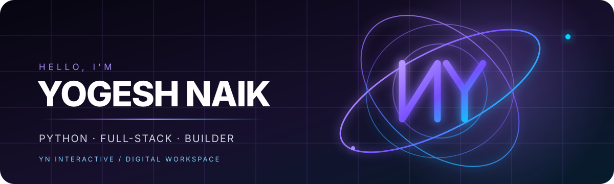

<div align="center">



<a href="https://readme-typing-svg.demolab.com"></a>

<a href="https://github.com/yogesh-hum"></a>
<a href="https://yn-interactive-rddn.vercel.app"></a>


</div>

---

<table>
<tr>
<td width="58%" valign="top">

## ◈ THE PERSON BEHIND THE CODE

Hey, I'm **Yogesh Naik** — a BCA student at **YCMOU**, based in Maharashtra, India.

I like understanding how things work, experimenting with technology, and turning what I learn into practical software.

- 🎓 Bachelor of Computer Applications — YCMOU
- 🐍 Growing my Python and full-stack development skills
- ⚙️ Interested in APIs, databases and useful web applications
- 🚀 Building and experimenting under **YN Interactive**

</td>
<td width="42%" valign="top">

## ◈ RIGHT NOW

```yaml
name: Yogesh Naik
role: Aspiring Developer
focus:
  - Python
  - Backend APIs
  - Full-Stack Web
learning:
  - FastAPI
  - React / Next.js
  - PostgreSQL
motto: "Learn. Build. Improve."
```

</td>
</tr>
</table>

## ◈ MY DEVELOPER JOURNEY

<div align="center">

| STAGE | FOCUS |
|:---:|:---|
| **01** | 🎓 BCA foundations — YCMOU |
| **02** | 💻 Programming — C, C++, Python, Java basics |
| **03** | 🌐 Web fundamentals — HTML, CSS, JavaScript |
| **04** | ⚡ Full-stack practice — React, Next.js, APIs, databases |
| **05** | 🚀 Current mission — build stronger, complete projects |

</div>

## ◈ TECH STACK

<div align="center">

**LANGUAGES**


**FRAMEWORKS · DATABASE · TOOLS**


</div>

<sub>Java is at a basic level. Other tools shown are technologies I've worked with or am actively learning.</sub>

---

## ◈ SELECTED PROJECTS

<table>
<tr>
<td width="50%" valign="top">

### 

**Personal portfolio & web presence**

A home for my development work and experiments.

<a href="https://yn-interactive-rddn.vercel.app"></a>

[View source ↗](https://github.com/yogesh-hum/YN-interactive)

</td>
<td width="50%" valign="top">

### 

**Learning & coding project**

A repository for class-related code and programming practice.

<a href="https://github.com/yogesh-hum/class-code"></a>

</td>
</tr>
</table>

---

## ◈ GITHUB ACTIVITY

<div align="center">


</div>

## ◈ CONTRIBUTION TRAIL

<div align="center">


</div>

---

<div align="center">

### LET'S BUILD SOMETHING MEANINGFUL.

<a href="https://github.com/yogesh-hum"></a>
<a href="https://yn-interactive-rddn.vercel.app"></a>

**DESIGNED & BUILT BY YOGESH NAIK** · YN INTERACTIVE

<sub>Curiosity in mind. Code in progress. Always building.</sub>


</div>
